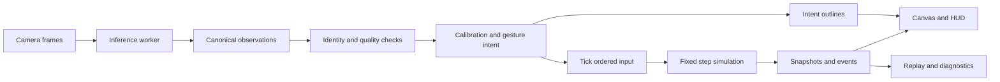

# Architecture and data contracts

## Runtime ownership

Use a standalone TypeScript/Vite application with Canvas rendering and small DOM overlays. Keep the current Planck release pinned for the first implementation. Use Vitest for pure rules and headless physics fixtures, Playwright for the production browser flow, and a separate camera-validation harness. These are future project components, not files created by this planning pass.

The main thread owns the simulation, route/session state, rendering, and UI. A worker owns inference and transfers compact observations. Pure tracking normalization and gesture logic can live in the worker or a dedicated processing module, but their output contract stays the same. Start with one worker so pose/hand results cannot race; add more concurrency only after profiling.

Physics alone determines body positions, contacts, resources, route progress, and failure. Rendering consumes snapshots; UI callbacks enqueue commands. Tracking never changes a Planck body or writes a route completion flag.

## Proposed module boundaries

Paths below are relative to the future `crux-motion/game/src` directory.

| Module | Responsibility |
|---|---|
| `camera/CameraSession.ts` | Permission, video element, device lifecycle, actual settings, stop/restart. |
| `camera/FrameScheduler.ts` | Fresh frames, monotonically increasing timestamps, one in-flight job, disposal. |
| `tracking/TrackingProvider.ts` | Common interface for paired MediaPipe tasks, Holistic, and replay fixtures. |
| `tracking/inference.worker.ts` | Model lifetime, inference, frame ownership, structured messages. |
| `tracking/CanonicalObservation.ts` | Raw pixels, named body points, source metadata, explicit coordinate spaces. |
| `tracking/HandIdentityTracker.ts` | Anatomical association, person continuity, ambiguous assignment handling. |
| `tracking/TrackingHealth.ts` | Freshness and quality state; no muscle/strength interpretation. |
| `tracking/AdaptiveFilter.ts` | Timestamp-aware filtering and bounded velocity estimation. |
| `calibration/CalibrationSession.ts` | Guided capture, sample validation, per-user profiles, comfortable envelope. |
| `gestures/HandFeatures.ts` | Scale-normalized bend, spread, opposition, and orientation features. |
| `gestures/GripClassifier.ts` | Prototype scores, unknown class, confidence margins. |
| `gestures/GestureState.ts` | Hysteresis, two-frame transitions, release priority, buffered ready intent. |
| `input/CameraIntentMapper.ts` | Observation-to-avatar reach and pull mapping. |
| `input/PracticeInput.ts` | Mouse/gamepad/keyboard tools using the same semantic contract. |
| `core/Simulation.ts` | Tick order, world lifetime, authoritative state, snapshots. |
| `core/CampusRig.ts` | Bodies, mass budget, joints, geometry, controller limits. |
| `core/ArmController.ts` | Free reach, held contraction, bounded joint motor targets. |
| `core/contact/GripConstraint.ts` | Finite directional solver constraint isolated from engine internals. |
| `core/contact/HoldContactSystem.ts` | Sweeps, patch eligibility, occupancy, acquisition, slip, release. |
| `core/DynoState.ts` | Physical phase classification and launch/catch events, no teleportation. |
| `core/FatigueModel.ts` | Actual load/work integration and smooth capacity curves. |
| `core/RouteSession.ts` | Checkpoints, goals, two-hand finish, retry, practice status. |
| `render/CampusRenderer.ts` | Physical arm drawing, passive legs, hand gesture art, overlap order. |
| `render/Camera.ts` | View framing only; no change to control coordinates. |
| `feedback/FeedbackDirector.ts` | Event deduplication, particles, audio, reduced motion. |
| `ui/CalibrationScreen.ts`, `GestureLab.ts`, `PlayHud.ts` | Concise player flows and readable diagnostics. |
| `replay/ReplayRecorder.ts`, `ReplayPlayer.ts` | Versioned semantic recording, playback, state hashes. |
| `persist/SaveStore.ts` | New namespaced progression, settings, calibration reset. |

Prefer a few cohesive files over blindly creating one file per function. These boundaries specify ownership and test seams, not a mandatory class hierarchy.

## Data contracts

All external data is validated at entry: finite numeric values, bounded sizes, known enum values, valid IDs, monotonic timestamps, and explicit schema version. Runtime data, authored content, and diagnostic recordings have separate schemas.

### Observation frame

| Field | Meaning and invariant |
|---|---|
| `schemaVersion`, `sessionId`, `sequence` | Reject stale sessions and repeated/out-of-order sequence numbers. |
| `videoTimeMs`, `acquiredAtMs`, `inferenceStartedAtMs`, `inferenceEndedAtMs` | Monotonic performance-clock metadata after an explicit clock mapping; distinguish video time from wall-clock time. |
| `sensorCaptureAtMs` | Optional; never populate with inference start and call it capture time. |
| `imageWidth`, `imageHeight`, `inputMirrored`, `rotation` | Required for coordinate normalization. |
| `provider`, `modelVersion`, `modelHash` | Exact reproducibility information. |
| `pose` | Named shoulders, elbows, wrists, optional hips, their image positions, and actual returned quality fields. |
| `detectedHands` | Unassigned observations with 21 landmarks and detector handedness scores; array position has no anatomical identity. |
| `qualityReasons` | Missing landmarks, stale frame, invalid geometry, or backend error; no fabricated confidence. |

Provider adapters must confirm the actual installed result field names from its types; current guide prose and examples may use different handedness field names. Normalize at the adapter boundary. Raw provider outputs do not leak into simulation modules.

### Calibration profile

Store version, provider/model compatibility, device token, input transform, calibrated anatomical assignment, shoulder scale, reach envelopes, elbow range, gesture feature prototypes, confusion results, selected release gesture, assistance settings, and created/updated dates. Treat a changed camera aspect ratio or orientation as a reason to verify/recalibrate. Do not identify a user biometrically or sync a calibration without a separate feature decision.

### Player intent

Each sample contains a sequence, effective tick, source observation sequence/time, calibrated left/right hand keys, shoulder-relative target in avatar meters, elbow flexion target, optional wrist orientation target, grip class, grip compatibility scores, release transition, tracking-health state, and declared input mode.

The envelope contains both hands in one atomic sample. Missing fields mean unknown, not zero. Explicit release transitions and session pause/resume commands have deterministic priority. Store which fields are measured estimates, calibrated estimates, or game mappings in diagnostics; do not call target velocity a measured force.

### Hold and patch

| Field | Contract |
|---|---|
| `id`, `shapeFamily`, `materialStyle` | Stable ID; jug/edge/sloper/pinch initially; style has no implicit physical behavior. |
| `positionM`, `rotationRad`, `outline` | Physical wall coordinates and rendered silhouette. |
| `patches` | Local contact geometry and anchors; each has an ID and occupancy limit. |
| `supportFrame` | Explicit force-on-hand normal/tangent, with local-to-world transform. |
| `forceRegion` | Finite normal/tangent capacities, cone/profile parameters, patch-specific reverse-direction rules. |
| `gestureRule` | Allowed shape classes, orientation sector, thresholds/profile reference. |
| `captureProfile` | Tolerance, finite force ramp, drift/slip thresholds. |
| `fatigueProfile` | Reference capacities and game drain modifiers. |
| `matching` | Capacity and minimum distinct patch spacing; no implicit double occupancy. |
| `role` | Start, ordinary, checkpoint, finish; role does not silently increase strength. |

Undercling and sidepull orientation derive from patch frame and gesture rules, not from a special infinite anchor flag. Store values in SI units where physical and mark dimensionless tuning coefficients explicitly.

### Route

Store ID/revision, name, unlock order, start rig pose/contact assignments, holds, wall bounds, fall boundary, explicit goals, finish patch IDs, finish dwell, profile requirements, teaching cue, and practice checkpoints. Initial contact assignments require a validated plausible pose; they are setup only, never an in-attempt shortcut.

Keep authoring solutions outside shipped runtime route rules. Runtime cannot examine a solution recipe to help the player secretly. Validate that goals reference real holds and that a two-hand finish has sufficient occupancy.

### Simulation snapshot and events

Snapshot: tick, session state, all body/joint poses, physical hand contact points, intent targets, hand contact state/hold/patch, simulated reaction/load ratio, reserves, motor effort, dyno phase, route goal progress, finish dwell, tracking protection state, and assistance flags.

Events carry unique IDs, tick, involved anatomical hand(s), patch IDs, and bounded magnitude/cause data. Initial event names: `GripReady`, `ContactAcquired`, `GripWarning`, `GripSlipping`, `HandReleased`, `DynoTakeoff`, `DynoCaught`, `RecoveryStarted`, `RecoveryStopped`, `TrackingPaused`, `TrackingResumed`, `RouteFinished`, `AttemptFell`. Do not use UI sound names as gameplay events.

### Replay

Store schema version, build ID, physics version/settings hash, route revision/hash, seed, calibration mapping snapshot, input mode, assistance flags, tick-indexed semantic samples, discrete transitions, and periodic state checksums. Preserve input-source age/quality for debugging but exclude raw camera frames by default.

Deterministic replay means the same build, engine version, configuration, and command stream reproduce the same result within declared tolerances. Do not promise bitwise equality across every browser or architecture. Landmark/model replay is a separate layer because inference may vary across delegates.

## Tick order

1. Apply lifecycle commands. If protected or manually paused, do not advance simulation time.
2. Consume due semantic inputs; reject stale session/sequence data and clear input transitions after consumption.
3. Resolve explicit releases and contact cancellations before considering acquisitions.
4. Update arm motor targets, limits, and grip capacity from the previous authoritative reserve state.
5. Acquire from the last completed hand sweep using fresh buffered intent, then step the world. A sweep detected after this step schedules acquisition at the next tick; with 120 Hz this bounds the delay without teleporting to an earlier pose.
6. Read reactions and motor work, integrate fatigue once, advance slip/dyno state, release failed contacts, and update route goals.
7. Check failure before finish if the same tick contains invalid support or mat collision. Finish requires two currently secure contacts for the full dwell.
8. Emit events and a read-only snapshot; record the consumed commands and state checksum.

For an 8.3 ms delayed swept catch, keep the contact anchor at the actual patch intersection and require the current hand still be within the maximum capture separation. If it has already passed too far, the catch fails; do not rewind or snap it. If this loses legitimate catches in tests, implement a documented substep contact check rather than enlarging an invisible magnetic radius.

## Timing and lifecycle details

Quantize each observation to a future/current unprocessed tick on receipt. Never retroactively modify a completed tick. Interpolate continuous targets between recent samples without extrapolating beyond the short quality policy; preserve discrete grip/release edges exactly once. Clear queues on retry, route change, model restart, and device change.

Use an accumulator for fixed simulation steps, bounded to prevent a spiral after a stall. After a large stall, enter protected pause instead of silently discarding physical time while gameplay appears live. Visibility/focus loss pauses immediately. Resume preserves body velocities and contacts, resets only input/filter history, and starts a new frame timestamp epoch where necessary.

Store progress under a new versioned namespace such as `crux-motion:v1`. Existing Crux saves remain untouched. Corrupt saves fall back to a clean profile with a recoverable message. Unknown route revisions cannot unlock redesigned routes without an explicit migration.

## Delivery layout

The coding agent should create `game/` for source/build tooling, `validation/` for concise reports and approved fixtures, and `assets/` or `game/public/` for licensed model/media assets. Keep this planning pack as documentation and update an implementation status file with actual progress. Do not commit dependency folders, personal camera recordings, or large unneeded generated artifacts.
